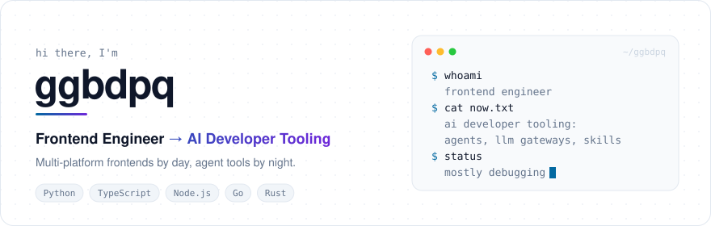

<picture><source media="(prefers-color-scheme: dark)" srcset="./assets/hero-dark.svg"></picture>

<picture><source media="(prefers-color-scheme: dark)" srcset="./assets/skills-dark.svg?v=20261031-06"></picture>

<picture>
  <source media="(prefers-color-scheme: dark)" srcset="https://github.com/ggbdpq/ggbdpq/raw/output/github-contribution-grid-snake-dark.svg">
  
</picture>

<picture><source media="(prefers-color-scheme: dark)" srcset="./assets/stats-dark.svg?v=20261031-06"></picture>

